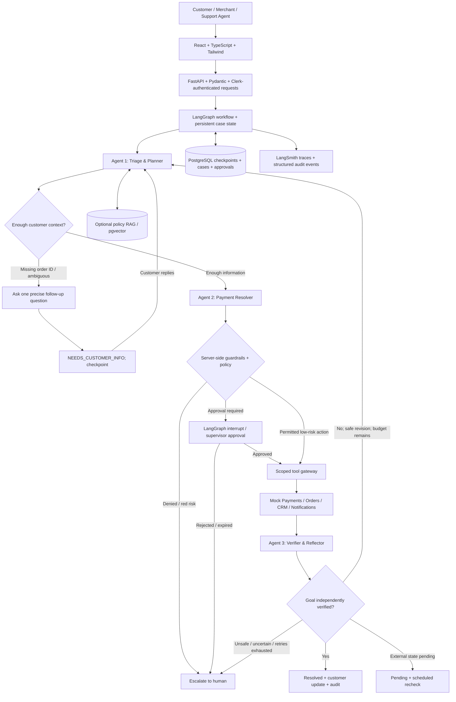

# SAATHI — Project Implementation Plan

> **Team:** PromptPioneers  
> **Hackathon:** Paytm Build for India AI — Hyderabad Edition  
> **Track:** 3 — Autonomous AI Teammates  
> **Product:** Saathi, an autonomous AI teammate for customer and merchant payment support  
> **Document type:** Engineering execution plan (proposed MVP; update as tasks are completed)  
> **Last revised:** November 14, 2026 — updated MVP and evaluation plan

## 0. Project status and ground rules

**Current baseline:** Initial backend slice implemented for synthetic case `CS-1043`: FastAPI case list/search/detail/run/events, typed models, server-scoped demo identity, guarded order reconciliation, independent order read-back, SQLite persistence, and atomic audit records. Fifteen tests pass for reconciliation, unsafe evidence, authorization, concurrency, restart persistence and rollback. This is a deterministic local bootstrap; LangGraph, OpenAI, PostgreSQL, refunds/approvals, React and the remaining fixtures/evaluation are not implemented yet. See `README.md` for local setup.

**Implementation goal:** Build a working **three-agent LangGraph** service with an OpenAI tool-calling model, a FastAPI backend, typed mock payment/order/CRM tools, persistence, enforced guardrails, a human approval gate, observable traces, and a React interface.

**Not claimed:** Production Paytm integration, permission to access Paytm customer data, real payment/refund processing, actual automation rates, or measured cost savings. The MVP must use **synthetic transactions** and clearly labeled mock services unless authorized sandbox access becomes available.

### Guiding principles

1. **Complete business tasks**, not just answer questions.
2. **Only verified backend evidence counts** as a successful outcome.
3. **The LLM proposes actions; server-side policy authorizes them.**
4. **Financial writes require an explicit, valid approval** in the MVP.
5. **Reflection is bounded (maximum three revisions); retries never bypass guardrails.**
6. **Never repeat a financial write simply because an API response timed out.**
7. **Build one reliable vertical slice before expanding channels or integrations.**
8. **Measure business outcomes with a repeatable 40-case evaluation before claiming success.**
9. **Ask for missing context and correct false assumptions before taking action.**

---

## 1. Product vision and scope

### One-sentence pitch

**Saathi investigates customer payment complaints, takes permitted actions across support systems, verifies the outcome, and escalates sensitive decisions to a human with complete context.**

### Who uses it

- **Customer:** Reports a duplicate charge, unpaid order, or refund-status issue.
- **Merchant support agent:** Reviews customer cases and takes over complex conversations.
- **Human supervisor:** Approves or rejects high-risk actions, such as a proposed refund.
- **Merchant operations team:** Reviews case resolution rate, time to action, and audit evidence.

### MVP use cases (proposed synthetic test scenarios)

| Case | Synthetic scenario | Desired outcome | Risk | Closure rule |
|---|---|---|---|---|
| `CS-1042` | Two captured payments for one order; ₹1,299 | Investigate duplicate, request approval, initiate **one** mock refund, track status | AMBER | Do not claim funds arrived until separately verified |
| `CS-1043` | ₹899 captured, but order says `UNPAID` | Reconcile permitted order state to `PAID` and read back | GREEN | Close only when order state is independently confirmed |
| `CS-1044` | ₹2,450 refund is `PROCESSING` | Retrieve status, notify accurately, keep pending and later recheck | GREEN (read-only) | Close only after final verified status defined by policy |
| `CS-1045` | ₹25,000 refund requested to an alternate account | Detect risk, block action, produce a human handoff | RED | No financial tool execution; escalation recorded |
| `CS-1046` | Customer says “I paid twice” but gives no order ID; after a follow-up, one charge is only pending | Ask for order ID, resume on reply, correct premise using payment evidence | GREEN read-only | No refund; send evidence-backed explanation and close only after verification |

### Context-driven P0 decision: refund history changes risk

For the **same** otherwise-eligible duplicate-charge proposal, the mock policy checks the authenticated customer's refund history **before** classifying the case:

| Synthetic history in last 30 days | Illustrative P0 decision | Consequence |
|---|---|---|
| 0–1 prior refunds | `AMBER` | Create human approval for exact proposed refund; no write until approved |
| 2 or more prior refunds | `RED` | Block ordinary refund execution and escalate for enhanced human review; do not treat history alone as proof of fraud |

These are **configurable demo-policy thresholds**, not Paytm rules or a production fraud decision. Count only refunds for the correct `tenant_id` and `customer_ref`, and exclude failed/cancelled/refused requests if the adopted policy defines prior refunds as completed/initiated refunds. Fixture `RISK-HISTORY-02` replays the duplicate-payment scenario with two prior refunds to show the outcome changing solely because of context. An ordinary `AMBER` supervisor approval cannot override a `RED` block; enhanced escalation is separate and does not initiate a refund in the MVP.

### Must-have functionality (P0)

- [ ] Customer/merchant case list with searchable details and case-linked conversation UI.
- [ ] Three collaborating agent roles sharing **one durable case state**.
- [ ] Explicit plan → resolve → verify/reflect → revise/finish/escalate flow.
- [ ] Server-side risk classification and permission checks before every tool call.
- [ ] Human approval queue with **approve, reject, expire** decisions.
- [ ] Tool gateway with typed schemas, audit events, idempotency, and synthetic data.
- [ ] Bounded reflection and safe timeout recovery.
- [ ] Accurate case/refund statuses and user-facing response wording.
- [ ] Multi-turn chat that pauses for missing order ID, resumes on reply and corrects a mistaken premise using evidence.
- [ ] Customer-refund-history lookup and a deterministic **context-dependent** risk rule in P0.
- [ ] Repeatable **40-case synthetic batch evaluation** producing measured metrics, per-case traces, and a run summary.
- [ ] End the demo with a **business impact** view: observed eligible-case resolution/human involvement and a clearly assumed financial scenario.
- [ ] Guided demo with five primary cases, plus a refund-history risk variant.

### Nice-to-have (P1, only after P0 passes)

- [ ] Policy RAG using approved synthetic merchant policy documents and pgvector.
- [ ] Mem0 for explicitly allowed, tenant-scoped non-sensitive memory.
- [ ] Live updates via Server-Sent Events (SSE) or WebSockets.
- [ ] Asynchronous refund-status polling with a job worker.
- [ ] LangSmith trace deep links and an evaluation dashboard.
- [ ] MCP tool adapters for future external systems.

### Out of scope for hackathon MVP

Real payment settlement, actual Paytm production credentials, automated merchant onboarding, WhatsApp/voice, financial fraud adjudication, general sales automation, and production-grade regulatory certification.

---

## 2. Target architecture: maximum three agents

**Keep the existing reflection pattern.** Add three specialist agents **inside** a LangGraph-controlled workflow. Auth, guardrails, risk policy, human approvals, storage, notification and the tool gateway are **platform components, not extra agents**.



**Interpretation:** The graph can re-plan; it cannot use reflection to authorize forbidden tools. The verifier looks up system state, not just the resolver agent's narrative.

### Agent contracts

| Agent | Input | Output | Allowed behavior | Prohibited behavior |
|---|---|---|---|---|
| **A1 — Triage & Planner** | Case message, authorized context, policy snippets, prior events | `intent`, `objective`, `evidence_needed`, `proposed_steps`, uncertainty | Ask for missing facts, handle multi-turn clarification, challenge unsupported customer premises using verified evidence, choose read-only tools, create a structured plan | Direct money movement or permission changes |
| **A2 — Payment Resolver** | Validated plan, case state, authorized tool catalog | Tool requests and structured results | Read payments/orders, propose reconciliation/refund, request exact-action approval, execute authorized mock tools | Call raw payment APIs directly, bypass approval, invent success |
| **A3 — Verifier & Reflector** | Goal, actual tool outputs, backend read-backs, iteration count | `VERIFIED`, `REVISE`, `PENDING`, or `ESCALATE` with evidence | Compare expected vs observed state; request safe bounded replanning | Mark refund settled from an `INITIATED` status; blindly retry writes |

### Structured output example

```json
{
  "case_id": "CS-1042",
  "intent": "duplicate_payment",
  "goal": "approved_refund_initiated_and_tracked",
  "action": "request_refund_approval",
  "risk_tier": "AMBER",
  "requires_human_approval": true,
  "evidence_refs": ["TXN-52A", "TXN-52B"],
  "confidence_note": "Two captured payments appear linked to one intended purchase"
}
```

The model output is advisory. The backend recalculates risk, validates the amount, actor, merchant scope, target transaction, prior refunds, and approval before any write.

---

## 3. Reflection and safe iteration

### Core logic

1. **Understand:** Normalize the message, tenant, authorized customer and desired business outcome; if an essential identifier is missing, ask a focused follow-up and checkpoint `NEEDS_CUSTOMER_INFO`.
2. **Plan:** Agent 1 resumes after any customer clarification, incorporates verified refund history, and creates a minimal action plan grounded in available evidence and policy.
3. **Guard:** Validate tool choice, risk, tenant, amounts, action permissions and required approval.
4. **Act:** Agent 2 invokes a scoped tool; record request ID and state changes.
5. **Observe:** Obtain an independent backend read-back or status inquiry.
6. **Reflect:** Agent 3 compares actual state with acceptance criteria.
7. **Branch:** Complete, remain pending, revise a safe step, or escalate.

### Iteration policy

- `MAX_REFLECTION_REVISIONS = 3` (proposed demo policy, not an established benchmark).
- Increment revision count when the planner changes course; do not count status polling as fresh planning.
- Retrying **read-only** queries after a recoverable error is allowed within limits.
- For any **write** with a timeout/unknown result: first query the action by immutable reference or idempotency key; **never blindly resubmit**.
- Escalate after the budget is exhausted or when evidence remains contradictory.
- Use checkpointed state so a workflow resumes after supervisor review without replaying completed writes.

```python
# Pseudocode — conceptual, not a production implementation
while state.status not in TERMINAL_STATES:
    plan = triage_and_plan(state)
    if plan.missing_required_fields:
        ask_customer_for_specific_fields(state, plan.missing_required_fields)
        state.status = "NEEDS_CUSTOMER_INFO"
        save_checkpoint(state)
        break  # same case resumes only on an authorized customer reply
    decision = policy_engine.evaluate(plan, state, authenticated_actor)
    if decision.denied:
        escalate(state, reason=decision.reason)
        break
    if decision.needs_approval:
        pause_for_human_approval(state, exact_action=plan.action)
        break  # resumes from checkpoint when an authorized decision arrives
    result = guarded_tool_gateway.execute(plan.allowed_action)
    observation = read_verified_system_state(result)
    verdict = verifier_reflector.evaluate(state.goal, observation)
    if verdict == "VERIFIED":
        resolve(state)
    elif verdict == "PENDING":
        track_pending_external_state(state)
        break
    elif verdict == "REVISE" and state.reflections < 3:
        state.reflections += 1
    else:
        escalate(state, reason="unverified or unsafe to continue")
        break
```

**Case statuses:** `NEW → NEEDS_CUSTOMER_INFO / INVESTIGATING → NEEDS_APPROVAL / ACTION_RUNNING / PENDING_EXTERNAL / VERIFYING / ESCALATED → RESOLVED` (transitions constrained by the backend).

**Refund statuses:** `NOT_REQUESTED → APPROVED → INITIATED → PROCESSING → SUCCEEDED / FAILED` (mock settlement events). The customer must see the true status; initiating a refund is **not** proof of credit to their bank account.

---

## 4. Tech stack and adoption order

| Layer | Proposed technology | MVP use | Notes |
|---|---|---|---|
| Frontend | **React, TypeScript, Tailwind** | P0 | Build a component-based customer and supervisor interface |
| API/backend | **Python, FastAPI, Pydantic** | P0 | Server-side authz, typed input/output, case APIs and tool gateway |
| Authentication | **Clerk** | P0 or mocked local auth for offline demo | Verify identity on backend; **Clerk login is not authorization** |
| LLM | **OpenAI tool-calling model** | P0 (with offline mock fallback) | Never give LLM unrestricted payment credentials |
| Agent workflow | **LangGraph** | P0 | Three-agent graph, state persistence and approval interrupts |
| Relational data | **PostgreSQL** | P0 | Case/action/approval/audit/checkpoint records |
| Knowledge/RAG | **pgvector** | P1 | Approved merchant policy corpus; tenant filtering |
| Memory | **Mem0** | P1 | Optional non-sensitive, tenant-scoped memory; not required for workflow state |
| Guardrails | Pydantic + deterministic policy service + RBAC + HITL | P0 | Approval and amount checks **outside** LLM |
| Evaluation | **pytest + 40-case synthetic batch runner**, optional **LangSmith** | **P0 batch + tests**; P1 hosted tracing UI | Report measured business outcomes, exact denominators, failure categories and repeatable run metadata |
| Packaging | **Docker** + cloud hosting | P0/P1 | Local `docker compose` first; optional deployment |
| Future integrations | **MCP** | P1 | Only if it simplifies multiple tool providers |
| Background jobs | Redis + Celery or simpler worker | P1 | Async refund tracking; can be simulated during MVP |
| Telemetry / CI | OpenTelemetry, GitHub Actions | P1 | Introduce after core flow is stable |

**Implementation status:** All technologies listed here are proposed until the team confirms each component in the project repository. Mark implemented features in the milestone checklist only after verification.

---

## 5. Suggested repository layout

```text
saathi/
├── README.md
├── plan.md
├── .env.example                 # placeholder variable names only; NO real secrets
├── docker-compose.yml           # optional local PostgreSQL
├── apps/
│   ├── web/                     # React + TypeScript + Tailwind
│   │   └── src/
│   │       ├── components/      # Chat, CaseCard, AgentTimeline, ApprovalCard
│   │       ├── pages/           # Inbox, CaseDetail, Approvals, Analytics
│   │       ├── api/             # typed backend client
│   │       └── types/
│   └── api/                     # FastAPI
│       ├── app/main.py
│       ├── app/routes/          # cases, approvals, mock events, metrics
│       ├── app/agents/          # triage, resolver, verifier
│       ├── app/graph/           # LangGraph state, nodes, edges, checkpoints
│       ├── app/tools/           # strictly scoped tool gateway + mock adapters
│       ├── app/policy/          # deterministic risk and authorization rules
│       ├── app/models/          # Pydantic + persistence models
│       ├── app/services/        # case, approval, audit, notification, metrics
│       ├── app/data/            # synthetic seed fixtures
│       ├── eval/                # 40 synthetic cases, runner, scoring, report outputs
│       └── tests/               # unit + integration + safety tests
└── docs/
    ├── architecture.md
    ├── api-contracts.md
    ├── security-and-risk.md
    ├── demo-script.md
    ├── business-impact.md       # measured numbers versus assumptions
    └── single-vs-multi-agent.md # architecture trade-off and judge answer
```

### Development conventions

- One `case_id` identifies a support case; one `tenant_id` scopes every business object.
- One `action_id` and one **idempotency key** identify each consequential action.
- Every tool has typed input/output schemas and a risk tier.
- Do not store raw PAN, CVV, bank credentials, auth tokens or unredacted secrets in traces.
- Use a centralized status enum and consistent frontend/backend types.
- Every pull request must include the tested scenario and screenshots/traces if UI-facing.

---

## 6. Core data model

These are **illustrative tables**, not a claim that a database already exists.

| Table | Minimal fields | Purpose |
|---|---|---|
| `support_cases` | `id`, `tenant_id`, `customer_ref`, `order_ref` (nullable), `goal`, `status`, `started_at`, `first_action_at`, `resolved_at`, `created_at`, `updated_at` | Durable case lifecycle, including clarification and timing |
| `payment_transactions` | `transaction_ref`, `tenant_id`, `order_ref`, `amount_minor`, `currency`, `status` | Synthetic payment ledger |
| `orders` | `order_ref`, `tenant_id`, `status`, `total_minor`, `payment_ref` | Mock reconciliation state |
| `refunds` | `refund_ref`, `tenant_id`, `customer_ref`, `transaction_ref`, `amount_minor`, `status`, `created_at`, `idempotency_key` | Mock refund tracking and scoped refund-history checks |
| `action_requests` | `action_id`, `case_id`, `tool_name`, `request_hash`, `idempotency_key`, `status` | Audit and duplicate-action prevention |
| `approvals` | `approval_id`, `action_id`, `reviewer_ref`, `decision`, `payload_hash`, `expires_at` | Authorization for exact financial action |
| `tool_events` | `event_id`, `case_id`, `tool_name`, `outcome`, `request_id`, `timestamp` | Redacted action evidence |
| `case_checkpoints` | `thread_id`, `case_id`, `revision`, `state_ref` | LangGraph recovery |
| `knowledge_documents` | `doc_id`, `tenant_id`, `policy_version`, `approved`, `content_ref` | P1 knowledge governance |
| `conversation_messages` | `message_id`, `case_id`, `sender`, `text_redacted`, `timestamp` | Durable multi-turn clarification and response history |
| `evaluation_runs` | `run_id`, `fixture_version`, `policy_version`, `model_id`, `seed`, `started_at`, `completed_at`, `status` | Reproducible batch-evaluation metadata |
| `evaluation_results` | `run_id`, `case_id`, `expected_outcome`, `observed_outcome`, `correct`, `human_touches`, `elapsed_ms`, `token_usage`, `safety_violations`, `trace_ref` | Measured case-by-case outcomes |

Use integer minor currency units (e.g. paise) for stored financial amounts; present rupees in the UI. Add unique indexes/constraints for `action_id`, `refund_ref`, and idempotency keys within the appropriate scope.

---

## 7. Backend API contracts (mock-service MVP)

| Method | Endpoint | Purpose | Security / safety requirement |
|---|---|---|---|
| `GET` | `/api/cases` | List visible cases | Tenant filter and role permission |
| `GET` | `/api/cases/{case_id}` | Fetch case, goal, current state | Tenant filter |
| `POST` | `/api/cases/{case_id}/run` | Start/resume workflow | Idempotent case-run guard |
| `GET` | `/api/cases/{case_id}/events` | Agent + tool activity trace | Sensitive fields redacted |
| `POST` | `/api/cases/{case_id}/messages` | Accept clarification reply and resume graph | Tenant-scoped identity + message validation + checkpoint-safe resume |
| `GET` | `/api/approvals` | Reviewer work queue | Supervisor-only |
| `POST` | `/api/approvals/{approval_id}/decision` | Approve/reject exact action | Valid auth + reviewer identity + non-expired payload hash |
| `POST` | `/api/mock/transactions/lookup` | Read synthetic transaction | Scoped read-only access |
| `POST` | `/api/mock/orders/reconcile` | Set mock order to paid when eligible | Policy check and read-back verification |
| `POST` | `/api/mock/refunds/initiate` | Initiate one mock refund | Exact-action approval + idempotency + prior-refund check |
| `GET` | `/api/mock/refunds/{refund_ref}` | Query synthetic refund status | Read-only access |
| `POST` | `/api/mock/refunds/history` | Read scoped customer's previous refund count/status | Internal tool only; tenant/customer scoping; read-only |
| `POST` | `/api/mock/refunds/{refund_ref}/settle` | Admin demo event only | Clearly marked **simulation**; restricted to demo operators |
| `POST` | `/api/cases/{case_id}/handoff` | Create human escalation | Include evidence and agent steps |
| `GET` | `/api/metrics` | Current test/demo outcomes | Compute from records; label simulated data |
| `GET` | `/api/evaluations/latest` | Latest completed 40-case batch summary | Demo/reviewer-safe aggregate; do not expose sensitive trace content |

### Approval request example

```json
{
  "approval_id": "APR-1042",
  "case_id": "CS-1042",
  "action_id": "ACT-1042-REFUND",
  "proposed_action": "initiate_mock_refund",
  "source_transaction_ref": "TXN-52B",
  "amount_minor": 129900,
  "currency": "INR",
  "reason": "Likely duplicate captured payment",
  "evidence_refs": ["TXN-52A", "TXN-52B"],
  "decision": "REQUESTED"
}
```

Upon approval, bind `reviewer_id`, `reviewed_at`, `expires_at`, and a hash of the proposed action. Changing the amount, source transaction, merchant, or destination must require a new approval.

---

## 8. Frontend screens / components

| Page / component | Requirements | Success criteria |
|---|---|---|
| **Case Inbox** | Five primary fixtures, risk badge, status, amount, last update | Select case and view stable linked details |
| **Case Detail** | Evidence, customer message, transaction/order references | Distinguish actual backend state from AI suggestion |
| **Chat** | Multi-turn customer messages, clarifying question, resumed case, evidence-grounded response | Request missing order ID; correct false duplicate-charge claim; never claim pending refund settled |
| **Agent Timeline** | Triage → Resolver → Verifier, tool results, revision count | Displays true event sequence from API |
| **Human Approvals** | Proposed action, amount, evidence, approve/reject | Only authorized supervisor can decide |
| **Outcome View** | `RESOLVED`, `PENDING_EXTERNAL`, `ESCALATED` plus reason | Reflects verified backend result |
| **Demo Controls** | Load fixture, inject one timeout, simulate settlement | Clearly labeled as **demo-only** |
| **Metrics / Business Impact** | Batch denominators, eligible automatic resolutions, human touches, first action times and illustrative savings | Measured values from a completed run; assumptions visually separated |

**Visual direction:** Follow the Saathi Stage 1 pitch branding: white/light backgrounds, navy headings, teal accents, restrained status colors, clear hierarchy, and readable action traces. Avoid overcrowding a judge-facing screen.

---

## 9. Three-developer ownership and work split

These responsibilities follow the report's suggested ownership; they can be reassigned by the team.

| Team member | Primary ownership | Deliverables | Integration dependency |
|---|---|---|---|
| **Vamshi Muluguri — Team Lead** | LangGraph architecture, OpenAI tool calling, agent prompts, reflection policy, batch-eval criteria | Agent nodes, graph state, multi-turn resume, bounded revision, evaluation scoring and end-to-end orchestration | Needs typed API schemas and mock tools from Akash |
| **Sai Teja Atkapuram — Developer** | React/TypeScript UI, multi-turn case chat, approval UX, metrics view, Clerk integration | Case inbox, chat clarification/resume, agent timeline, approval queue, business-impact closing view | Needs stable REST contracts and API event formats |
| **Akash Bhalshankar — Developer** | FastAPI, PostgreSQL, mock payment/order APIs, refund-history policy, evaluation fixtures/tests | Secure tool gateway, contextual risk rules, 40-case dataset, audit log, test automation | Publishes testable tool contracts for Vamshi and Sai Teja |

### Shared responsibilities

- All three: API contract review, one daily integration check, pairing on payment safety, final rehearsal.
- Lead: merge gates and judges' demonstration narrative.
- Any change to action authorization, risk policy, approval, or settlement state requires **two-person review** before merge.

### Definition of ready for a task

- Acceptance criteria stated.
- Sample request/response or UI state provided.
- Dependencies and risk classification identified.
- Test case selected.

### Definition of done for a pull request

- [ ] Feature works end-to-end against synthetic data.
- [ ] Happy-path and at least one failure-path tests pass.
- [ ] No secret/PII leakage or authorization bypass introduced.
- [ ] Event trace shows who/what caused each state change.
- [ ] Documentation and demo instructions updated.

---

## 10. Milestones and sprint board

**Scheduling note:** The blocks below are a **relative build order**, not an assertion of the organizer's deadline. Parallelize tasks where dependencies permit. Keep the final milestone for integration and rehearsal; do not use the last block for adding new features.

### M0 — Repo and contracts (all three)

- [ ] Create repository and branches (`main`, short-lived feature branches).
- [ ] Initialize the React frontend and FastAPI backend applications.
- [ ] Create `.env.example` with placeholder variables, `.gitignore`, lint/test setup.
- [ ] Agree on case/refund/approval states and JSON schemas.
- [ ] Fix five primary synthetic case fixtures plus a duplicate-charge refund-history variant.
- [ ] Define `NEEDS_CUSTOMER_INFO`, missing-ID clarification prompt and resumed-message contract.
- [ ] Lock **40 labeled synthetic evaluation fixtures** (category, initial messages, follow-ups, expected risk and final state) with deterministic seed.
- [ ] Document the maximum-three-revisions rule and financial-write retry policy.

**Exit:** A teammate can clone the repository and understand fixtures, interfaces, and ownership.

### M1 — Mock backend and policy engine (Akash lead; Vamshi reviews)

- [x] Set up FastAPI app and Pydantic models (initial reconciliation slice).
- [ ] Add synthetic payments, orders, refunds, support cases and events.
- [ ] Implement guarded read tools: `get_transaction`, `get_order`, `get_refund_status`.
- [x] Implement `reconcile_order` with tenant and eligibility validation (internal deterministic workflow; public mock-tool endpoint remains pending).
- [ ] Implement `initiate_mock_refund` requiring an approval record and idempotency key.
- [ ] Add redacted audit events and deterministic risk policy (GREEN/AMBER/RED).
- [ ] Add failure-injection fixture: one read timeout / uncertain write response.
- [ ] Implement tenant-scoped `get_refund_history` and policy `refunds_30d >= 2 => RED` for new mock refund requests.
- [ ] Seed ambiguous multi-turn `CS-1046`: missing ID; later one captured payment plus one pending authorization.

**Exit:** All five primary scenarios and the refund-history risk variant can be executed through deterministic typed mock tools without an LLM.

### M2 — Working three-agent graph (Vamshi lead; Akash pairs)

- [ ] Define shared LangGraph case state and checkpoint storage.
- [ ] Implement Agent 1: intent triage, focused clarification question and structured plan.
- [ ] Persist `NEEDS_CUSTOMER_INFO` state and resume only when an authenticated case-linked customer reply arrives.
- [ ] Include scoped refund-history evidence in risk evaluation; the model never sets the final risk tier.
- [ ] Implement Agent 2: tool requests **through** the policy/tool gateway.
- [ ] Implement Agent 3: verified read-back, reflection decision, pending/escalation.
- [ ] Implement conditional graph edges and maximum three revisions.
- [ ] Connect an OpenAI tool-calling model behind an abstraction.
- [ ] Provide deterministic offline demo mode if model access is unavailable.
- [ ] Ensure the model cannot construct arbitrary action payloads outside schemas.

**Exit:** Case `CS-1043` reconciles and verifies successfully; `CS-1044` remains accurately pending.

### M3 — Human approval and safety (Vamshi + Akash, Sai Teja UI)

- [ ] Create server-side approval requests tied to exact action ID and payload hash.
- [ ] Add LangGraph interrupt for approvals and resume via checkpoint.
- [ ] Add approve, reject, expire and changed-request invalidation paths.
- [ ] Add supervisor-only UI decisions and proof of reviewer identity.
- [ ] Block all unapproved financial writes and cross-tenant records.
- [ ] Implement safe recovery from duplicate or uncertain refund initiation.
- [ ] Create handoff package containing facts, attempted steps, and reason.
- [ ] Confirm `RISK-HISTORY-02` changes an otherwise AMBER refund case to RED without creating any refund.

**Exit:** `CS-1042` pauses for approval; `CS-1045` escalates without a refund; replay does not duplicate a refund.

### M4 — Product interface and observability (Sai Teja lead; all integrate)

- [ ] Replace scripted case status with API-fed case detail and event timeline.
- [ ] Implement five primary case cards and **functional multi-turn chat**.
- [ ] Show history-driven risk change and the exact evidence supporting it.
- [ ] Render current agent, tool trace, approval request, loop counter, outcome.
- [ ] Add clear simulated-settlement and injected-timeout demo controls.
- [ ] Add UI states for loading, failure, missing authorization, pending and escalation.
- [ ] Wire metrics to backend records and label synthetic fixture results.
- [ ] Add an **evaluation summary** panel and short **business impact** closing view: measured run metrics on one side, savings assumptions on the other.
- [ ] Add LangSmith tracing **if available** and redact sensitive content.

**Exit:** A reviewer can run a case and understand every step without developer narration.

### M5 — Tests, freeze and demonstration (all three)

- [ ] Run security/safety acceptance matrix below.
- [ ] Run all **40 synthetic cases** via the batch runner and save raw case-level verdicts plus summary metrics.
- [ ] If any blocking P0 metric fails, fix and rerun; do not cherry-pick passing cases.
- [ ] Rehearse the multi-turn clarification and context-driven refund-history variant.
- [ ] Prepare the one-minute **single-agent versus three-agents** judge answer and a measured-business-outcome closing statement.
- [ ] Test an actual UI-to-API-to-agent-to-tool-to-DB flow.
- [ ] Freeze the demo fixtures and stop scope expansion.
- [ ] Prepare offline fallback: saved local UI + deterministic mock results.
- [ ] Prepare a short demonstration script, architecture screenshot and Q&A notes.
- [ ] Verify no UI language implies live Paytm integration or bank settlement.
- [ ] Rehearse a clean run and a controlled failure/recovery run.

**Exit:** All P0 acceptance tests pass and three developers can explain their respective components.

---

## 11. Test plan and acceptance criteria

### Automated acceptance matrix

| ID | Test | Required outcome | Priority |
|---|---|---|---|
| T01 | Captured payment + unpaid order | Authorized reconciliation to `PAID`; independent read-back passes | P0 |
| T02 | Duplicate charge, no approval | Create approval request; **zero refund writes** | P0 |
| T03 | Same case after valid supervisor approval | Exactly one mock refund created; customer sees `INITIATED`/`PROCESSING` | P0 |
| T04 | Approval rejected or expired | No refund; escalation/blocked status with reason | P0 |
| T05 | Repeat same refund command | Existing result returned; no second financial action | P0 |
| T06 | Refund write times out after possibly succeeding | Reconcile via action reference/status **before** retry | P0 |
| T07 | Existing refund already found | No duplicate refund initiation | P0 |
| T08 | Refund pending | Status remains pending; no false `RESOLVED` | P0 |
| T09 | Final settlement event received | Verify state and resolve only per closure policy | P0 |
| T10 | High-value alternate-account refund | Red-risk gate; block and human escalation | P0 |
| T11 | Prompt injection in customer message or policy text | Unauthorized tool request denied; no privilege change | P0 |
| T12 | Wrong tenant or unauthorized approval actor | Deny access/action; record security event | P0 |
| T13 | Max three reflection revisions reached | Exit to pending/escalation; no infinite loop | P0 |
| T14 | Web app refreshed while approval pending | Case resumes consistently from saved state | P0 |
| T15 | Missing LLM access | Demo degrades to declared deterministic mode without inventing agent execution | P1 |
| T16 | Customer reports double charge without order ID | Ask precisely for missing order ID; no refund/action before evidence | P0 |
| T17 | Customer supplies missing order ID in follow-up | Resume same case/checkpoint, preserve previous context, avoid duplicate tool calls | P0 |
| T18 | One captured payment plus one pending authorization | Correct mistaken “charged twice” premise; no refund, evidence-backed explanation | P0 |
| T19 | Otherwise valid duplicate refund, 0–1 prior refunds in 30 days | AMBER; approval required before any refund write | P0 |
| T20 | Same synthetic case with 2 prior refunds in 30 days | RED; **no ordinary refund approval/write**; escalate for review | P0 |
| T21 | Other tenant's refund history present | Not visible or counted; risk evaluated using scoped customer history only | P0 |
| T22 | 40-case batch runner | Each fixture executes/reset independently with expected vs observed verdict and trace | P0 |
| T23 | Outcome/economic metrics exported | Save denominators, latency, human touches and case-level evidence; label assumptions | P0 |
| T24 | Multi-turn with no usable order ID after follow-up | Ask one clear clarification or hand off per policy; do not fabricate ID | P0 |

### Proposed quality gates (targets, not measured results)

- **0** unauthorized financial writes in automated safety tests.
- **0** duplicate mock refunds per idempotent action.
- **0** false verified closures in the acceptance suite.
- **100%** correct human escalation for curated RED-risk test fixtures.
- **100%** of tool calls recorded with case, action reference and redacted outcome.
- All **five** primary seeded demo scenarios reach the intended `RESOLVED`, `NEEDS_CUSTOMER_INFO`, `PENDING_EXTERNAL`, or `ESCALATED` states as appropriate.
- **40/40 batch fixtures executed** and scored, with no silently skipped or failed-to-run cases (record such cases explicitly).
- **≥90% correct final business outcomes** across the synthetic run is an **initial target**, not an achieved score; mandatory safety gates remain stricter.
- **≥90% correct clarification/ambiguity handling** across the ambiguous-case subset is a **target**, not an achieved score.

### Reporting metrics

`verified_resolution_rate`, `eligible_autonomous_resolution_rate`, `false_closure_rate`, `human_approval_rate`, `correct_escalation_rate`, `tool_success_rate`, `p95_case_step_latency`, `time_to_first_verified_action`, `end_to_end_case_duration`, `cost_per_verified_resolution`, `idempotency_violation_count`, `human_touches_per_case`, `clarification_accuracy`, and `reflection_revisions_per_case`.

**Define denominators:** `eligible_autonomous_resolution_rate = eligible cases resolved with zero human touches / total eligible cases`; `correct_outcome_rate = cases whose observed terminal/pending state matches the expected state / 40`. Show `PENDING_EXTERNAL` separately; do **not** classify a pending refund as fully resolved. Record attempted/failed/unscored cases in the denominator and give reasons. Report median and p95 elapsed time for completed cases separately from pending cases; do not equate first-action time with bank settlement time.

Only publish measured values after running a repeatable test/pilot; otherwise show **target** or **illustrative** labels.

---

## 12. Batch evaluation: 40 synthetic cases (P0)

**Purpose:** Prove how often Saathi completes a verified business task, requests necessary context, escalates correctly, and avoids unsafe actions. This batch is **not** a production accuracy estimate, because fixtures are synthetic and selected by the team.

### Dataset design: exactly 40 cases

| Category | Count | Required behavior |
|---|---:|---|
| Payment/order mismatch | 8 | Eligible reconcile / verified backend read-back |
| Duplicate charge/refund request | 8 | Approval when allowed; refund-history-dependent RED escalation when warranted |
| Pending or already-refunded payment | 8 | Correct status; no second refund; no false closure |
| Multi-turn or ambiguous complaint | 6 | Ask for missing ID; resume; correct mistaken premise |
| Recoverable API failure / timeout | 5 | Safe read retry; write-outcome reconciliation; bounded reflection |
| High-risk or adversarial request | 5 | Deny unauthorized action, prevent cross-tenant access, human handoff |
| **Total** | **40** | **Every case must have an expected business outcome** |

Each fixture stores `case_id`, `category`, `tenant_id`, initial customer message, optional follow-up messages, synthetic tool responses, expected risk tier, expected calls/forbidden calls, expected case state, eligible-for-autonomy flag, and scoring rules. Store fixture version, model identifier, prompts/policy version, seed and timestamp with the run.

### Execution and scoring protocol

1. Reset the mock database to a known, clean seed **before each fixture**; isolate tenants and prior actions.
2. Run all 40 via `python -m app.eval.run_batch --dataset app/eval/fixtures_v1.json --output reports/latest` (CLI example; implement during M5).
3. Drive the real LangGraph → FastAPI → mock-tool workflow; inject scripted customer follow-ups at the expected pause point. A mocked LLM fallback must be labeled **deterministic mode**.
4. Judge success using stored backend state and action audit records; never accept the agent's own textual claim as the verdict.
5. Record latency, human approval/hand-off touches, reflection count, tool errors, duplicate writes, unauthorized writes, premature closures and estimated model/tool cost per case.
6. Save `evaluation_results.jsonl`, `evaluation_summary.json`, `evaluation_summary.md`, and a redacted trace reference per fixture. If the batch is rerun, retain run IDs instead of overwriting claimed results.

### Report card — template (populate only after execution)

| Metric | Measured result | Target / reporting rule |
|---|---|---|
| Cases executed and scored | `TBD / 40` | 40/40 with documented failures |
| Correct expected outcome | `TBD / 40 (TBD%)` | Initial goal ≥90% |
| Eligible autonomous resolution | `TBD / TBD eligible` | Show denominator; no unsupported target promise |
| Correct multi-turn handling | `TBD / 6` | Initial goal ≥90% |
| Correct high-risk escalation | `TBD / 5` | 100% target for curated RED cases |
| Unauthorized financial actions | `TBD` | **0 required** |
| Duplicate financial writes | `TBD` | **0 required** |
| False verified closures | `TBD` | **0 required** |
| Cases with human touch | `TBD / 40` | Report count and reasons |
| Median first verified action / case duration | `TBD / TBD` | Measured; separate pending external states |

**Important:** Do not place target percentages on a slide as if they were measured. If a run is incomplete, mark results **not yet measured**.

---

## 13. Demo presentation script and business close

### 0. Setup / positioning

Show the merchant-support workspace and state: “Saathi works on synthetic payment data in this demo. The system shows autonomous investigation, safe actions, verification and collaboration with human supervisors; it is not connected to Paytm production.”

### 1. Multi-turn ambiguity — `CS-1046` (new P0 spotlight)

1. Customer: **“I was charged twice. Refund one payment.”** No order ID supplied.
2. Agent 1 does **not** invent an order or call a refund tool. It asks: **“Could you share your order ID so I can verify both transactions?”**
3. Customer replies: **“ORD-2046.”** The graph resumes from `NEEDS_CUSTOMER_INFO` on the **same case**.
4. Agent 2 checks transaction statuses: one `CAPTURED`, the other `PENDING_AUTHORIZATION`, not two completed charges.
5. Agent 3 verifies the evidence. Saathi explains that a second successful payment is **not confirmed**, does not initiate a refund, and recommends tracking the pending authorization appropriately.

**Judge takeaway:** Saathi remembers context across turns and challenges an incorrect premise rather than taking a financially risky action.

### 2. Low-risk autonomous completion — `CS-1043`

1. Open payment captured/order unpaid mismatch.
2. Show the three-agent journey and allowed reconciliation action.
3. Show independent read-back: order changed to `PAID`.
4. Close only because the backend confirms the intended state.

**Judge takeaway:** Verified system change, not just a generated answer.

### 3. Context-sensitive risk and human approval — `CS-1042` plus `RISK-HISTORY-02`

1. Run base duplicate ₹1,299 case with **zero prior refunds**: AMBER, supervisor approval required.
2. Approve the exact proposed action and show **one** mock refund recorded as `INITIATED`/`PROCESSING` (not settled).
3. Reset the fixture and run the **same** type of complaint with **two prior refunds in 30 days**. The server-side policy changes AMBER → RED; no refund write, escalation recorded.
4. Explain the two outcomes were driven by verified history, not arbitrary LLM confidence.

**Judge takeaway:** The teammate uses business context while risk enforcement stays outside the model.

### 4. Reflection / bounded iteration — injected timeout

1. Inject one read-only verification timeout.
2. Show Agent 3 spotting missing evidence and sending a safe revision to Agent 1.
3. Show one permitted retry, a successful read-back and a recorded reflection counter.
4. Point out the hard three-revision limit; uncertain financial writes are reconciled, not blindly retried.

**Judge takeaway:** Self-correction is visible, controlled and verifiable.

### 5. Unsafe case / human collaboration — `CS-1045`

1. Show the ₹25,000 alternate-account refund request.
2. Show RED policy, financial action blocked, and a clear handoff containing evidence and attempted steps.

**Judge takeaway:** Saathi knows when to stop.

### 6. Closing beat — measured business outcomes, then illustrative savings

Show **one closing slide or dashboard view** titled **“Saathi: outcomes, not just answers.”** Populate the left side only from a completed 40-case run:

- `X / 40` cases reached the **correct verified business outcome** (includes correct pending/escalated states; not all are autonomous resolutions).
- `A / E` **eligible** cases were resolved without a human; `H / 40` cases required approval/handoff.
- Median time to first verified action: `T` seconds; `0` unauthorized writes and `0` duplicate refunds only **if actually measured**.

Put an explicitly separated **“Illustrative operating scenario — assumptions, not pilot results”** panel on the right:

- 100,000 monthly tickets; 30%, 45% or 60% assumed **fully automated**; ₹50 human-handled cost; ₹10 automated cost.
- Monthly gross handling-cost difference: 30% → **₹12 lakh**, 45% → **₹18 lakh**, 60% → **₹24 lakh** (`tickets × automation fraction × (₹50 − ₹10)`).
- At the 30% scenario, assuming **6 minutes** of avoided human handling time per fully automated case: `100,000 × 30% × 6 / 60 = 3,000 gross human-hours/month` **illustratively freed**, before QA, escalation and oversight time. This is not an observed saving.
- Excludes implementation, oversight, cloud, integration, reopens and other costs; not proof of net savings or realized adoption.

**20-second closing line:** “Saathi doesn't just answer ‘what happened.’ It checks the transaction, acts when authorized, verifies what changed, and brings in a person when it must. In our synthetic evaluation, we can show exactly how many cases reached the correct outcome, how many needed a human, and how safely the workflow behaved.” Replace this with **actual measured numbers** after the batch run.

**Stage 1 note:** If retaining the mandated seven-slide pitch, integrate this closing business story into its **Impact & Benefits** section; a separate business-impact slide can be used for the **live demo**, without implying the organizer required an extra Stage 1 section.

### Recommended demo artifacts

- [ ] Architecture image: three agents + reflection + guardrails + HITL.
- [ ] Multi-turn case transcript: missing order ID → clarification → corrected premise.
- [ ] Refund-history comparison: AMBER base case versus RED history variant.
- [ ] One screenshot each: verified closure, pending approval, reflection retry, escalation.
- [ ] Saved outputs from **all 40** evaluation cases plus the aggregate summary.
- [ ] Business-impact closing slide with **measured metrics versus assumptions** visually distinguished.
- [ ] One sample redacted agent trace and audit entry.

---

## 14. Judges' Q&A: why three agents instead of one?

**Short answer (30–45 seconds):**

> “A single agent could handle a basic FAQ or a straight-line lookup. Saathi needs to interpret incomplete customer messages, investigate transactions, request approved actions and independently verify whether the backend actually changed. We use three narrow roles: Agent 1 handles context and planning, Agent 2 uses approved support tools, and Agent 3 checks the evidence and reflects on failures. The policy engine and human approval sit outside all agents. This separation makes actions and errors easier to audit and test. We know multi-agent orchestration adds latency and cost, so we only keep it if evaluation shows the extra verification is worthwhile.”

| Design | When it wins | Trade-off | Saathi decision |
|---|---|---|---|
| Single-agent tool-calling | Simple lookup or one-step support issue | Less separation between planning, action and self-verification | Suitable baseline or fallback |
| Three narrow agents, one LangGraph state | Multi-turn investigation, approval, independent verification, reflection | More model calls, orchestration complexity and latency | Chosen design for financially sensitive multi-step cases |

**Follow-up if judges ask “Why not just add verifier code to a single agent?”** Say: “We already do: the decisive checks are deterministic server-side code. The third agent helps interpret conflicting tool evidence and propose bounded replanning, but it is not the final authority over settlement, permissions or case closure.”

**Do not claim a measured multi-agent advantage without an A/B experiment.** Optional P1 comparison: run the same 40 cases through a single-agent implementation with identical tools/policy/verification and compare accuracy, safety, latency and cost.

---

## 15. Risks and decisions

| Risk | Likely consequence | Mitigation / decision |
|---|---|---|
| Limited time for three developers | Incomplete workflows | Prioritize `CS-1043`, then approval case; defer Mem0/MCP |
| LLM inconsistency | Unreliable plans or unsupported claims | Typed plans, tool allowlists, deterministic policies, verifier read-back |
| Financial-write duplication | Multiple refunds | Immutable action IDs, idempotency keys, reconciliation before retries |
| Hallucinated completion | Customer misled | Status-based reply templates and independent backend verification |
| Cross-tenant data exposure | Privacy breach | Tenant checks in every query/tool, RBAC, minimal retained data |
| Prompt injection via chat or RAG | Unauthorized action | Treat all retrieved/user text as untrusted; tool-policy boundary |
| Approval replay / forgery | Unauthorized financial action | Backend-verified reviewer role, payload hash, expiration and one-time consumption |
| No external API access | Demo blocked | Use deterministic, clearly marked mock payment backend |
| Async refund processing | False “instant resolution” promise | Distinguish initiated, processing and settled; pending workflow state |
| Unrealistic savings projections | Credibility risk | Label financial assumptions and avoid presenting targets as outcomes |
| Biased or overbroad refund-history flags | Legitimate customer blocked | Use transparent synthetic thresholds, tenant-scoped lookups, escalation instead of automatic denial of a genuine claim |
| Weak synthetic evaluation design | Misleading success rate | Lock fixture set, clear denominators, report failed runs and holdout cases if time permits |
| Multi-turn state loss | Customer repeatedly questioned or wrong transaction used | Checkpoint `NEEDS_CUSTOMER_INFO`, bind replies to the same authenticated case |

### Architectural decisions to record in `docs/architecture.md`

- **ADR-001:** Why LangGraph for stateful three-agent orchestration.
- **ADR-002:** Why policy and approvals run outside the LLM.
- **ADR-003:** Why mock backend precedes any sandbox integration.
- **ADR-004:** Why reflection is bounded and write retries require reconciliation.
- **ADR-005:** Why pgvector/Mem0 are P1, not release blockers.
- **ADR-006:** Why multi-turn clarification checkpoints before financial decisions.
- **ADR-007:** Why refund history is a server-side risk input rather than agent discretion.
- **ADR-008:** Why measured 40-case evaluation and impact assumptions are shown separately.

---

## 16. MVP launch / readiness checklist

### Product

- [ ] Five primary cases and a refund-history variation available from synthetic seed data.
- [ ] Case state shown consistently in UI, API, DB and audit events.
- [ ] Agent timeline makes clear when humans are involved.
- [ ] Chat responses distinguish initiated, pending, verified and escalated.
- [ ] Missing order ID produces a clarifying question, retains context and resumes safely.
- [ ] Context-sensitive RED escalation is visible and explainable.

### Safety

- [ ] No direct external financial actions from model output.
- [ ] Any refund write requires approval tied to **exact** transaction/amount.
- [ ] Sensitive tools deny unauthorized users and cross-tenant data.
- [ ] Idempotency and timeout reconciliation tests pass.
- [ ] No raw payment credentials or customer secrets in fixtures/traces.

### Engineering

- [ ] Fresh local setup works from README instructions.
- [ ] Unit, integration and safety tests pass.
- [ ] A complete 40-case evaluation run produces retained per-case and aggregate reports.
- [ ] Measured counts, denominators and first-action timing are available for the closing demo.
- [ ] The demo can run without live network/payment credentials.
- [ ] An error or interrupt does not destroy the case state.
- [ ] Docker environment, if used, starts cleanly.

### Submission honesty

- [ ] Current implementation versus proposed features clearly labeled.
- [ ] Screenshots of simulated values labeled **demo/mock**.
- [ ] Any automation or cost-saving percentage labeled **target/projection** until measured.
- [ ] Present measured *synthetic test* results as such, not as a real merchant pilot or business ROI.
- [ ] Closing business-impact slide visibly separates measured demo outcomes from assumptions.
- [ ] No suggestion of an official Paytm partnership or production integration.

---

## 17. Handover and next actions

### First working session (all three)

1. Lock the five primary scenarios, refund-history variant, and approval/closure rules.
2. Agree on `CaseState`, tool schemas, and `ApprovalRequest` schema.
3. Create backend mock endpoints and seed fixtures before adding LLM reasoning.
4. Choose one vertical slice: **payment/order mismatch → action → verified closure**.
5. Integrate the approval-gated duplicate-payment path after the slice works.
6. Add the `CS-1046` multi-turn path and the risk-history policy comparison.
7. Run the 40-case batch and prepare the measured-business-outcome closing view and 3-vs-1 agent Q&A.

### P0 build order if time becomes tight

**Mock backend → Case state graph → One verified autonomous workflow → Guardrails + history-dependent risk → Human approval → Multi-turn clarification → Reflection/recovery → UI integration → 40-case measured evaluation → Business-impact demo.**

Do **not** sacrifice guardrails, approval or verifiable backend state in order to add RAG, more agents, channels or a flashier dashboard.

### Source basis

This plan is based on the **Saathi PromptPioneers Detailed Project Report**, the **seven-slide Stage 1 pitch**, and the multi-agent architecture agreed by PromptPioneers. The sprint ordering, task breakdown, APIs, synthetic evaluation protocol, and quality targets are **proposed implementation decisions**, not completed engineering work or official hackathon requirements. No evaluation performance numbers are claimed until a real batch run succeeds.
